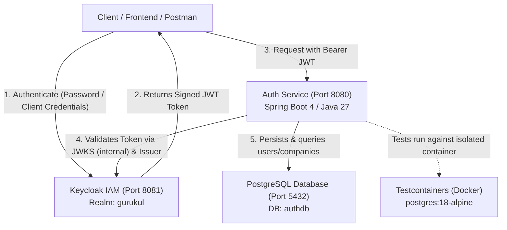

# Gurukul Tutor - Authentication & Identity Service

A modular, enterprise-grade Java 27 & Spring Boot 4 microservices monorepo designed for the **Gurukul Tutor** educational and learning platform.

---

## Architecture Overview



### Core Components

1. **`auth-service`**:
   - **Spring Boot 4.1.2** on **Java 27**.
   - Feature-based packaging (`company`, `user`, `security`, `config`, `web`, `dto`).
   - Dual-channel JWT token validation (internal container-to-container JWKS URI and browser-facing issuer URI).
   - Role and authority mapping from Keycloak's `realm_access.roles` and `resource_access.<client>.roles` into Spring Security `ROLE_*` authorities.
   - Dynamic principal resolution via Keycloak's `preferred_username` claim.
   - Customized `AuthenticationEntryPoint` (HTTP 401) and `AccessDeniedHandler` (HTTP 403) returning standardized JSON error payloads.

2. **Infrastructure (`infra/`)**:
   - **PostgreSQL 18** (`postgres:18-alpine`): relational storage for users, companies, and roles.
   - **Keycloak 26.8.2** (`quay.io/keycloak/keycloak:26.8.2`): OpenID Connect (OIDC) identity and access management. Preconfigured with realm `gurukul` and client `auth-service`.

3. **Testing with Testcontainers**:
   - All repository, service, and controller integration tests run on dynamic, ephemeral PostgreSQL Testcontainers (`postgres:18-alpine`).
   - Driven via Spring Boot's `@ServiceConnection` for zero-configuration port binding.
   - Tests use realistic educational and corporate domain test data (institutions like Stanford, Harvard, TCS, Infosys, and users like faculty, associates, and students) rather than artificial dummy mocks.

---

## Prerequisites

- **Java 27 SDK**
- **Docker** and **Docker Compose v2+**
- **Maven 3.9+** (or use included `./mvnw` wrapper)
- **curl** and **jq** (for API testing)

---

## Project Structure

```
gurukul-tutor/
├── Makefile                       # Root automation for build, test, and docker operations
├── README.md                      # Comprehensive project documentation
├── apps/
│   └── docker-compose.yml         # Application deployment (auth-service)
├── infra/
│   ├── docker-compose.yml         # PostgreSQL 18 & Keycloak 26.8.2
│   ├── init-db/
│   │   └── 01-init.sql            # Base DDL schema initialization
│   └── README.md                  # Infrastructure guide
└── auth-service/
    ├── Dockerfile                 # Multi-stage layered jar build
    ├── pom.xml                    # Spring Boot 4.1.2, Testcontainers, OAuth2 Resource Server
    └── src/
        ├── main/
        │   ├── java/com/gurukul/authservice/
        │   │   ├── AuthServiceApplication.java
        │   │   ├── company/       # Company entity, repository, and service
        │   │   ├── config/        # Startup data initializers
        │   │   ├── dto/           # Data transfer objects and requests
        │   │   ├── exception/     # Global exception handlers and error models
        │   │   ├── security/      # Spring Security, JwtDecoder, Converter, Utils, UserContext
        │   │   ├── user/          # User entity, repository, service, and Access enum
        │   │   └── web/           # REST Controllers (Auth, User, Company)
        │   └── resources/
        │       └── application.yaml
        └── test/
            ├── java/com/gurukul/authservice/
            │   ├── BaseIntegrationTest.java        # Shared Testcontainers integration base class
            │   ├── TestcontainersConfiguration.java# Dynamic PostgreSQL Testcontainer bean
            │   ├── company/       # CompanyRepositoryTest, CompanyServiceTest
            │   ├── keycloak/      # KeycloakJwtTest
            │   ├── security/      # JwtAuthenticationConverterTest, JwtUtilsTest, UserContextTest
            │   ├── user/          # UserRepositoryTest, UserServiceTest
            │   └── web/           # AuthControllerTest, UserControllerTest, CompanyControllerTest
            └── resources/
                └── application.yaml
```

---

## Monorepo Microservices & Makefile Architecture

The root [`Makefile`](file:///mnt/ssd/Project/java/gurukul-tutor/Makefile) is structured to support any number of microservices within the monorepo while maintaining clean separation between infrastructure, individual services, and global operations.

### Microservice Auto-Detection
The Makefile automatically scans the repository for any directory containing a `pom.xml` (e.g. `auth-service`, `tutor-service`, etc.):
```makefile
SERVICES ?= $(if $(DETECTED_SERVICES),$(DETECTED_SERVICES),auth-service)
```
Any new microservice added under the monorepo root is automatically discovered and immediately inherits all lifecycle targets (`<service>-up`, `<service>-down`, `<service>-build`, `<service>-test`, `<service>-clean`, `<service>-run`, `<service>-logs`).

---

### Command Organization & Reference

#### 1. Global Commands (Affects All Microservices & Infra)

| Command | Description |
| :--- | :--- |
| `make up` | Starts infrastructure (PostgreSQL + Keycloak) and all application containers in Docker. |
| `make down` | Gracefully stops and removes all application containers and infrastructure. |
| `make restart` | Executes a clean restart of the entire monorepo stack. |
| `make test` | Runs tests across **all** microservices using Testcontainers and actual test data. |
| `make build` | Compiles and packages jars and builds Docker images across **all** microservices. |
| `make clean` | Cleans target directories and build artifacts across **all** microservices. |
| `make ps` | Displays status of all containers (infrastructure + applications). |
| `make health` | Queries the health check endpoint (`/actuator/health`). |

#### 2. Infrastructure Commands (PostgreSQL & Keycloak)

| Command | Description |
| :--- | :--- |
| `make infra-up` | Starts infrastructure services (`gurukul-postgres` + `gurukul-keycloak`). |
| `make infra-down` | Stops infrastructure containers. |
| `make infra-restart`| Restarts infrastructure containers. |
| `make infra-logs` | Streams live logs from PostgreSQL and Keycloak. |
| `make infra-ps` | Displays running status of infrastructure containers. |
| `make infra` | Convenient alias for `make infra-up`. |

#### 3. Microservice Lifecycle Commands (`<service>-<action>`)

Each detected microservice (e.g., `auth-service`) provides the following dedicated targets:

| Command Pattern | Example (`auth-service`) | Description |
| :--- | :--- | :--- |
| `<service>-up` | `make auth-service-up` | Builds and starts the service container in Docker (ensures infra is running). |
| `<service>-down` | `make auth-service-down` | Stops and removes the service container. |
| `<service>-restart` | `make auth-service-restart` | Clean restart of the service container. |
| `<service>-build` | `make auth-service-build` | Packages jar via Maven and builds Docker image. |
| `<service>-test` | `make auth-service-test` | Runs Testcontainers integration tests & unit tests for this service. |
| `<service>-clean` | `make auth-service-clean` | Cleans `target/` build directory for this service. |
| `<service>-run` | `make auth-service-run` | Runs the service locally on the host via Spring Boot (`./mvnw spring-boot:run`). |
| `<service>-logs` | `make auth-service-logs` | Streams live logs for this service container. |
| `<service>` | `make auth-service` | Shortcut alias for `<service>-up`. |

#### 4. Composable Multi-Target Execution

Because targets are standard GNU Make goals, you can combine options in a single command:

```bash
# 1. Bring up a specific service alongside infrastructure
make auth-service infra up

# 2. Start multiple microservices and infrastructure
make auth-service infra

# 3. Test a single specific service
make test SERVICE=auth-service
# or
make auth-service-test

# 4. Build a single specific service
make build SERVICE=auth-service
# or
make auth-service-build

# 5. Clean a single specific service
make clean SERVICE=auth-service
# or
make auth-service-clean
```

#### 5. Developer & Token Helpers

| Command | Description |
| :--- | :--- |
| `make keycloak-token-client` | Fetches a signed Keycloak JWT using `client_credentials` grant for `auth-service`. |
| `make keycloak-token-user` | Fetches a signed Keycloak JWT using `password` grant for user `sateesh`. |
| `make git-status` | Displays git working tree status. |

---

## Authentication & Security Model

### Dual-Channel Token Validation

In containerized deployments, Spring Security needs to retrieve Keycloak's JSON Web Key Set (JWKS) over the private Docker network (`http://keycloak:8080/...`), while tokens issued to user browsers specify the public host issuer (`http://localhost:8081/realms/gurukul`).

`SecurityConfig.java` defines a custom `JwtDecoder`:
```java
@Bean
@ConditionalOnMissingBean
public JwtDecoder jwtDecoder() {
    NimbusJwtDecoder jwtDecoder = NimbusJwtDecoder.withJwkSetUri(jwkSetUri).build();
    OAuth2TokenValidator<Jwt> withIssuer = JwtValidators.createDefaultWithIssuer(issuerUri);
    jwtDecoder.setJwtValidator(withIssuer);
    return jwtDecoder;
}
```

### Role Mapping

Keycloak tokens place roles in `realm_access.roles` and `resource_access.<client>.roles`.
[`JwtAuthenticationConverter`](file:///mnt/ssd/Project/java/gurukul-tutor/auth-service/src/main/java/com/gurukul/authservice/security/JwtAuthenticationConverter.java):
1. Reads roles from `realm_access.roles` (e.g. `ADMIN`, `TEACHER`).
2. Reads client roles from `resource_access.*.roles`.
3. Normalizes them into Spring Security authorities with uppercase `ROLE_` prefix (`ROLE_ADMIN`, `ROLE_TEACHER`).
4. Maps `preferred_username` to the principal's name.

### Role Hierarchy & Access Levels

Users are categorized via the [`Access`](file:///mnt/ssd/Project/java/gurukul-tutor/auth-service/src/main/java/com/gurukul/authservice/user/Access.java) enum:
- `ADMIN (1)`: Global platform administrator.
- `ASSOCIATE (2)`: Corporate / institution administrator.
- `TEACHER (3)`: Faculty member / instructor.
- `STUDENT (4)`: Enrolled student.
- `TEMP (5)`: Newly registered user awaiting assignment.

---

## API Endpoints

### Public Endpoints

| Method | Endpoint | Description |
| :--- | :--- | :--- |
| `GET` | `/actuator/health` | Service health status. |
| `GET` | `/actuator/info` | Application metadata. |
| `GET` | `/v3/api-docs/**` | OpenAPI documentation. |
| `GET` | `/swagger-ui/**` | Swagger UI interface. |

### Protected Endpoints (Requires Bearer JWT)

| Method | Endpoint | Description | Required Role |
| :--- | :--- | :--- | :--- |
| `GET` | `/api/v1/auth/me` | Fetch authenticated user profile from token claims. | Authenticated |
| `GET` | `/api/v1/users` | List all users. | Authenticated |
| `POST` | `/api/v1/users` | Register a new user under a company. | Authenticated |
| `GET` | `/api/v1/users/{id}` | Get user details by primary key ID. | Authenticated |
| `PUT` | `/api/v1/users/{id}` | Update user details. | Authenticated |
| `DELETE` | `/api/v1/users/{id}` | Delete user account. | Authenticated |
| `GET` | `/api/v1/users/username/{username}` | Find user by username (scoped to caller's company). | Authenticated |
| `GET` | `/api/v1/users/company/{companyId}` | List members enrolled under an institution. | Scoped to own company |
| `GET` | `/api/v1/users/company/{companyId}/page` | Paginated list of members under an institution. | Scoped to own company |
| `GET` | `/api/v1/companies` | List organizations (Gurukul Admin: all; Company user: own company). | Authenticated |
| `GET` | `/api/v1/companies/page` | Paginated list of organizations. | Authenticated |
| `POST` | `/api/v1/companies` | Register a new partner organization (Auto-creates company admin user). | **Gurukul Admin Only** |
| `GET` | `/api/v1/companies/{id}` | Get organization by ID. | Scoped to own company |
| `PUT` | `/api/v1/companies/{id}` | Update organization profile. | Scoped to own company |
| `DELETE` | `/api/v1/companies/{id}` | Delete organization. | **Gurukul Admin Only** |

---

## Multi-Tenant Architecture & Company Data Isolation

The platform enforces strict multi-tenant boundaries across both company and user features:

### 1. Gurukul Admin (Superadmin) Privileges
- **Role & Company Identification**: A caller is recognized as a Gurukul Admin if they possess `ROLE_GURUKUL_ADMIN` or possess `ROLE_ADMIN` under the platform root company (`GURUKUL`, `companyId: 1`, seeded default user `sateesh`).
- **Company Creation**: **Only Gurukul Admin has permission to register new companies** via `POST /api/v1/companies`. Requests from any other company admin or member are rejected with `403 FORBIDDEN`.
- **Global Cross-Tenant Visibility**: Only Gurukul Admin can view all companies across the platform and manage users across different institutions.

### 2. Automatic Company Admin User Provisioning
- When a company is registered (via `POST /api/v1/companies` or `CompanyService.create()`), a decoupled domain event `CompanyCreatedEvent` is published within the same transactional boundary.
- The `CompanyUserEventListener` in the `user` module listens to this event and **automatically provisions an initial administrator user** for that company:
  - **Username**: Same name as the company (with collision fallback).
  - **Access Level**: `Access.ADMIN` (`ROLE_ADMIN`).
  - **Company ID**: Bound directly to the newly created company's primary key.
  - **Password**: Securely BCrypt-hashed (`$2a$...`).

### 3. Strict Company Data Isolation
- **User Creation Boundary**: A company admin/associate can **only create users under their own company**. Any attempt to specify a different `companyId` is rejected with `403 FORBIDDEN`.
- **User Read Isolation**:
  - `GET /api/v1/users` and `GET /api/v1/users/page` are automatically scoped to the caller's company (`findByCompanyId`). Non-Gurukul users can never see users from other companies.
  - Direct lookups via `GET /api/v1/users/{id}`, `GET /api/v1/users/username/{username}`, and `GET /api/v1/users/company/{companyId}` reject foreign-company requests with `403 FORBIDDEN`.
- **User Mutation Boundary**: Users cannot update or delete accounts belonging to another company. Users cannot be reassigned to a different company unless performed by a Gurukul Admin.

### 4. Modular Package Encapsulation
- Package-private boundaries are strictly preserved across both modules:
  - `Company`, `CompanyRepository`, `CompanyServiceImpl` in `com.gurukul.authservice.company`.
  - `User`, `UserRepository`, `UserServiceImpl`, `UserPrincipal`, `CustomUserDetailsService` in `com.gurukul.authservice.user`.
  - Modules interact only through public service contracts (`CompanyService`, `UserService`) and domain events (`CompanyCreatedEvent`), avoiding circular dependencies and preventing architectural leakage.

---

## Live Testing with Keycloak Tokens

### 1. Test Unauthenticated Request (Expect 401)

```bash
curl -i http://localhost:8080/api/v1/users
```
**Response:**
```json
{
  "status": 401,
  "error": "UNAUTHORIZED",
  "message": "Authentication required. Please provide a valid JWT token.",
  "timestamp": "2026-11-14T17:45:34.336"
}
```

### 2. Obtain a JWT Token

**Option A: Client Credentials Grant (Service Account)**
```bash
TOKEN=$(make keycloak-token-client)
```

**Option B: Password Grant (User Account)**
```bash
USER_TOKEN=$(make keycloak-token-user)
```

### 3. Call Protected API

```bash
# Call current user endpoint
curl -i -H "Authorization: Bearer $USER_TOKEN" http://localhost:8080/api/v1/auth/me

# List users
curl -i -H "Authorization: Bearer $TOKEN" http://localhost:8080/api/v1/users

# List partner companies
curl -i -H "Authorization: Bearer $TOKEN" http://localhost:8080/api/v1/companies
```

---

## Testing with Testcontainers

The test suite runs against real, isolated Docker containers provisioned dynamically via Testcontainers, mirroring the production environment:

```bash
# Run entire test suite (all microservices)
make test

# Or for auth-service specifically
make auth-service-test
```

### Dual-Container Architecture in `TestcontainersConfiguration`

[`TestcontainersConfiguration.java`](file:///mnt/ssd/Project/java/gurukul-tutor/auth-service/src/test/java/com/gurukul/authservice/TestcontainersConfiguration.java) provisions both infrastructure dependencies:
1. **`PostgreSQLContainer<?>` (`postgres:18-alpine`)**:
   - Manages an ephemeral `authdb` database instance.
   - Bound automatically to Spring Boot via `@ServiceConnection`.
2. **`GenericContainer<?>` (`quay.io/keycloak/keycloak:26.8.2`)**:
   - Runs Keycloak in `start-dev` mode with HTTP enabled.
   - Wait strategy verifies OIDC discovery endpoint (`/realms/master/.well-known/openid-configuration`) returns HTTP 200 before tests run.
   - Dynamically registers OIDC `issuer-uri` and `jwk-set-uri` using Spring Framework's `DynamicPropertyRegistrar`:
     ```java
     @Bean
     public DynamicPropertyRegistrar keycloakDynamicProperties(GenericContainer<?> keycloakContainer) {
         return registry -> {
             String authServerUrl = "http://" + keycloakContainer.getHost() + ":" + keycloakContainer.getMappedPort(8080);
             registry.add("spring.security.oauth2.resourceserver.jwt.issuer-uri", () -> authServerUrl + "/realms/master");
             registry.add("spring.security.oauth2.resourceserver.jwt.jwk-set-uri", () -> authServerUrl + "/realms/master/protocol/openid-connect/certs");
         };
     }
     ```

### Testcontainers Verification Tests

[`AuthServiceApplicationTests.java`](file:///mnt/ssd/Project/java/gurukul-tutor/auth-service/src/test/java/com/gurukul/authservice/AuthServiceApplicationTests.java) asserts the operational health of both containers:
- **`shouldVerifyPostgresContainer()`**: Asserts `postgresContainer.isRunning()`, database name `authdb`, username `authuser`, and valid JDBC URL.
- **`shouldVerifyKeycloakContainer()`**: Asserts `keycloakContainer.isRunning()`, queries the mapped port's OIDC discovery endpoint, and validates HTTP 200 with OIDC discovery claims (`issuer`, `jwks_uri`).
- **`jwtDecoder` resolution**: Asserts Spring Security's `JwtDecoder` bean successfully resolved certificates from the active Keycloak Testcontainer.